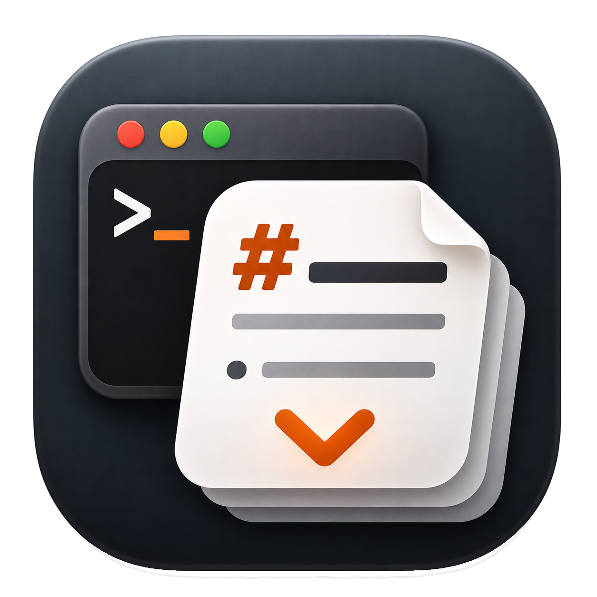

# mdmore

**`more` for Markdown, with syntax highlighting.** One fast Rust binary. No browser, no server, no fuss.



```rust
fn main() {
    let words = ["fast", "small", "colourful"];
    println!("mdmore is {}", words.join(", "));
}
```

> Read the docs where you already are: in the terminal, in colour, at full speed.

| Press | To |
|---|---|
| `space` / `b` | Page down / up |
| `/` | Search, then `n` / `N` |
| `t` | Open the table of contents |
| `Enter` | Follow a link, such as [the README](README.md) |
| `q` | Quit |

## Every language, properly coloured

```python
from dataclasses import dataclass

@dataclass
class Page:
    title: str
    lines: list[str]

    def headline(self) -> str:
        return f"{self.title} ({len(self.lines)} lines)"
```

```typescript
type Theme = "ansi" | "Monokai Extended" | "Nord";

export async function preview(path: string, theme: Theme = "ansi") {
  const res = await fetch(`file://${path}`);
  return { theme, text: await res.text() };
}
```

```bash
# Install, then read anything
cargo install --path .
mdmore --theme Nord README.md
git log --oneline | head -5 | mdmore -
```

```go
package main

import "fmt"

func main() {
	for i, word := range []string{"fast", "small", "colourful"} {
		fmt.Printf("%d. %s\n", i+1, word)
	}
}
```

```sql
SELECT title, COUNT(*) AS views
FROM pages
WHERE format = 'markdown'
GROUP BY title
ORDER BY views DESC
LIMIT 10;
```

```json
{ "version": "0.1.0", "environment": "release", "commit": "db4e1e6" }
```

## Everything else you'd expect

- Headings, **bold**, *italic* and `inline code`
- Nested lists that wrap cleanly
  - with hanging indents
  - at any terminal width
- Tables, block quotes and rules
- Inline images on iTerm2, Kitty and Sixel terminals

1. Open a file: `mdmore notes.md`
2. Pipe one in: `cat notes.md | mdmore`
3. Exit early on short files: `mdmore -F notes.md`

---

| Feature | mdmore | plain `more` |
|---|---|---|
| Rendered Markdown | **Yes** | No |
| Highlighted code | **Yes** | No |
| Table of contents | **Yes** | No |
| Follow links, back and forward | **Yes** | No |
| Search | Yes | Yes |

See [the README](README.md) for keys and themes, or [TEST.md](TEST.md) for a feature checklist.
